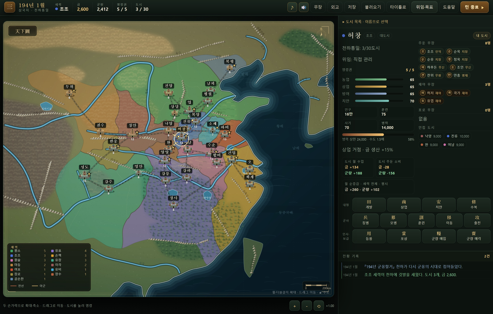
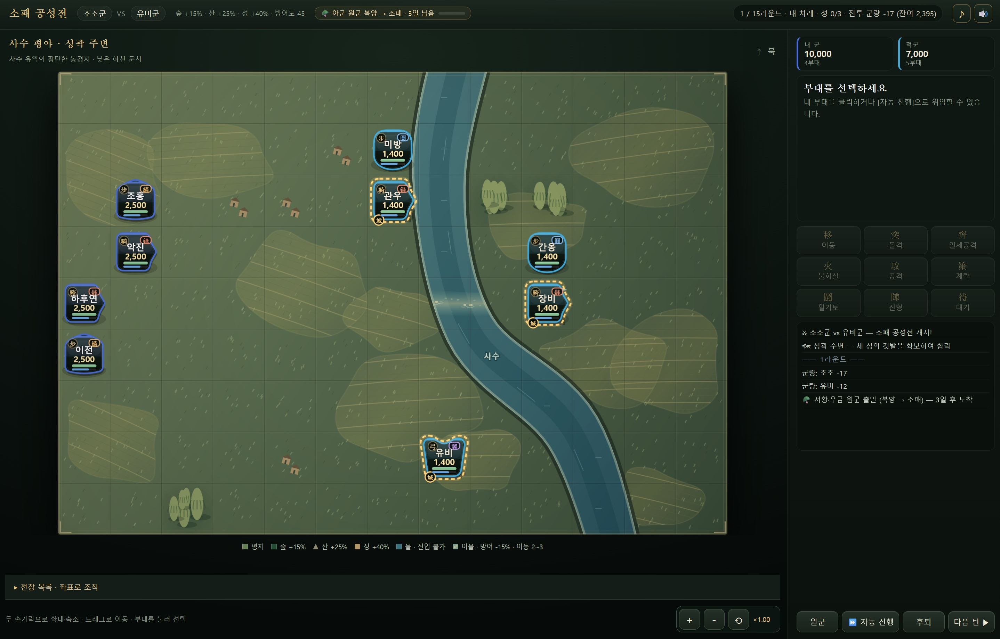

# 삼국지 : 천하통일 (Three Kingdoms: Unification)

<p align="center">
  
  
</p>

삼국지5 스타일의 **턴제 전략 시뮬레이션 게임**. 역사 4개·가상 대전 1개 시나리오에서 세력을 골라
30개 도시를 모두 점령해 천하를 통일하는 것이 목표입니다. 설치 없이 브라우저에서 실행됩니다.

## 실행 방법

1. `index.html` 을 브라우저(Chrome/Edge)로 엽니다. (파일 더블클릭 또는 드래그)
2. 시작 화면에서 시나리오와 플레이할 세력을 선택합니다. (★ = 난이도/세력 크기) **[전체 AI 관전]**을 누르면 세력 선택 없이 모든 세력이 AI로 진행됩니다.
3. 지도에서 내 도시를 클릭 → 명령을 내리고 → **[턴 종료 ▶]** 로 한 달을 진행합니다.

> `file://` 로 열어도 동작합니다. 인터넷/서버 불필요.

## 웹 배포 (GitHub Pages)

- 웹 실행 주소: https://kirinonakar.github.io/Three_kingdoms/
- `main` 브랜치에 푸시하면 **Deploy GitHub Pages** Actions가 `npm test`를 실행하고, 통과한 버전을 자동 배포합니다. Actions 탭에서 **Run workflow**로 `main`을 수동 배포할 수도 있습니다.
- 최초 설정은 저장소 **Settings → Pages → Build and deployment → Source → GitHub Actions**입니다. 비공개 저장소의 Pages는 지원되는 GitHub 유료 플랜이 필요합니다.
- 배포에는 `index.html`, `js/`, `assets/`, `AUDIO_CREDITS.md`만 포함됩니다. 빌드 패키지 설치나 별도 배포 토큰은 필요 없습니다.

## AI 에이전트 플레이

도시 목록과 좌표별 전장 표로 캔버스 좌표 추측 없이 조작할 수 있습니다.
페이지의 `GameAgent.observe()`로 상태·현재 UI 조작을 JSON으로 읽고,
`GameAgent.act({ revision, id, value? })`로 실제 게임 UI와 같은 경로로 실행합니다.
사용법과 전체 관찰/행동 형식은 [AGENT_PLAY.md](AGENT_PLAY.md)를 참고하세요.

## 화면 구성

- **상단바** — 연월 · 세력 · 금 · 군량 · 명령권 · 도시 수, 무장/외교/저장/불러오기/도움말, 턴 종료.
- **지도** — 해안·산지 윤곽 안에 도시별 영토를 소유 세력색으로 채색합니다. 구역은 자연스럽게 굽은 경계를 공유하며, 세력 간 국경은 먹선·같은 세력의 도시 경계는 옅은 점선으로 표시합니다. 점령 시 영토색도 갱신됩니다. 수도 ★, 내 도시 금점, 도시 호버 툴팁, 좌하단 세력 범례. 도시를 클릭해 명령합니다. 이동 명령 중에는 목적지 후보 도시가 금색 점선으로 강조되고, 지도에서 클릭해 목적지를 고를 수 있습니다.
- **도시 패널** — 능력치 바, 병력·훈련·사기, 월 수입/주둔 소비 예보, 주둔 무장, 인접 도시 바로가기, 명령 버튼(내정/군사/인사).
- **전황 기록** — 날짜별로 구분된 색상 로그.
- **전투** — 좌측 격자 전장, 우측 전황 카드 · 부대 정보 · 행동 버튼 · 전투 로그.
- **반응형** — 좁은 화면에서는 지도 아래로 패널이 이동합니다.

## 게임 요소

### 시나리오
- **194년 군웅할거**: 13세력의 난전.
- **200년 관도대전**: 원소·조조의 대치와 손권의 강동 계승, 여남의 유비 등 8세력.
- **208년 적벽대전**: 북방을 장악한 조조, 손권·유비 동맹, 서쪽 군웅 등 6세력.
- **219년 한중왕 쟁패**: 조조·유비·손권의 3세력 구도.
- **가상 대전 : 15군웅**: 250년의 가상 대전. 군웅 15명이 지역 2곳과 장수 10명씩을 나누어 출발합니다.
- 연월, 도시 소유, 군주, 초기 병력·훈련·자원, 장수 배치와 등장 여부가 달라집니다. 역사적 구도를 30도시 게임판에 축약한 배치이며, 능력치·출현 시점은 게임 설정입니다.

### 턴 구조
- **1턴 = 1개월**. 매달 명령권 = `보유 도시 수 + 2`개. 남은 명령권은 턴 종료 시 소멸합니다.
- **각 무장은 한 달에 한 번만 명령에 참여**할 수 있습니다. (내정·군사·등용) 포상·외교는 무장 행동을 소모하지 않습니다.
- **첫 2개월은 AI가 플레이어 도시를 공격하지 않습니다.** (내정·징병을 준비할 시간)
- 턴 종료 → AI 세력 행동 → 월간 정산(금·군량 수입, 충성도, 사기 회복, 랜덤 이벤트) → 다음 달.
- AI가 행동하는 동안에는 [턴 종료]·[저장]·[무장 일람]·[외교] 버튼이 잠깁니다.

### 도시
- 능력치: 농업(군량), 상업(금), 방어도(전투 방어 보정), 치안(금·군량 생산과 징병 효율), 인구(병력 상한 = 인구×1000, **수도는 1.5배**).
- 거점 규모: 인구 **9만 미만은 소도시**, **9만 이상은 중도시**, **14만 이상은 대도시**입니다. 토성·누각·이중 성벽과 망루로 지도 표식을 구분하며, 전장 성곽도 같은 규모를 사용합니다.
- 병력 상한: `인구(만) × 1,000`, **수도는 1.5배(× 1,500)**. 이동·전투 복귀로 초과 주둔할 수 있으며, 초과 병력은 군량을 두 배로 소비합니다.
  - 충원은 **징병**(도시당 월 1회, 1명당 금 0.08, 치안 -5, 신병 훈련 30/사기 55)과 **모병**(반복 가능, 1명당 금 0.16, 치안 -1, 신병 훈련 55/사기 75)으로 나뉩니다. 둘 다 명령 1과 무장 1명을 사용하며, 기존 병력과 훈련·사기를 인원 비율로 합칩니다. 비용은 올림합니다.
- 도시 패널에서 **도시별 월 수입·급료·군량 소비**, **모든 보유 도시를 합산한 세력 전체 월 순증감·비축 지속 기간**, **인접 도시 바로가기**, 주둔 무장을 한눈에 볼 수 있습니다. 무장 선택 화면에서 내정과 충원의 정확한 비용·효과를 미리 확인합니다.
- 지도 위 도시에 마우스를 올리면 병력·훈련·사기·내정 수치가 툴팁으로 표시됩니다.
- 지도는 최대 4배까지 확대할 수 있습니다. 오른쪽 위 미니맵은 현재 보고 있는 영역을 표시하며, 누른 위치로 이동합니다. 모바일에서는 세력 일람을 지도 아래에 표시하고, 도시명은 공간이 있으면 성 위에 배치합니다.
- **방어도**는 공성전에서 수비측 방어력을 높입니다. 0~50은 기존 보정(방어도 50: 방어력 +12.5%)을 유지하고, 50 초과부터 추가 강화하여 100에서는 +38%가 됩니다. 이 비율은 최종 피해 감소율이 아니라 피해 계산에 쓰는 방어력의 배율입니다. 함락 시 60%로 떨어지며 [수복]으로 다시 올립니다.

### 무장 (총 217명)
- **시기별 등장**: 194년부터 활동하는 무장 외에 **제갈량(207) · 사마의(208) · 방통(209) · 육손(203) · 강유(228) · 등애(240) · 두예(255)** 등
  후대 무장은 **설정된 등장 연도**에 맞춰 해당 지역에 나타납니다. 등장 도시를 지배하는 세력이 있으면 그 세력에 합류하고,
  아니면 재야로 남아 [등용]으로 설득할 수 있습니다. 아직 등장하지 않은 인물은 무장 일람·등용 목록에 나오지 않습니다.
- 능력치: 무력(전투·일기토), 지력(계략·내정 보조), 정치(내정), 매력(징병·등용).
- **특기**: 천하무쌍 / 무쌍 / 무신 / 용맹 / 지장 / 모사 / 명재 / 인덕 — 전투·내정·등용 보너스.
- **충성도**: 45 미만이면 매달 배신(재야로 이탈) 위험. 포상(금 100)으로 올립니다.
- **수장(★)**: 세력 수장은 충성도 100으로 고정되며, 배신하거나 포로가 되지 않습니다.
- **포로**: 전투에서 사로잡은 무장은 해당 도시에 머물며 [등용]으로 설득할 수 있습니다.
  그 도시를 원래 세력이 되찾으면 자동으로 해방됩니다.

### 명령
| 구분 | 명령 | 설명 |
|---|---|---|
| 내정 | 개발·상업·치안·수복 | 1/2/3명 배치에 금 60/95/130. 정치·지력·명재 특기로 상승. 추가 무장 효과 65%/40%, 최대치 근처 비용 비례 감액 |
| 군사 | 징병 | 매력 기반 충원 — **도시당 월 1회**, 1명당 금 0.08·치안 -5. 저렴한 미숙련병 |
| 군사 | 모병 | **비용 2배**(1명당 금 0.16)·치안 -1. 훈련·사기가 더 높은 지원병, 같은 달 반복 가능 |
| 군사 | 훈련 | 훈련도·사기 상승. 훈련도 100에서도 사기 회복 가능 |
| 군사 | 이동 | 인접 아군 도시로 무장·병력 이동 — **지도에서 목적지 도시를 클릭**하거나 목록에서 선택 (상한 초과 주둔 시 군량 소비 증가) |
| 군사 | 출진 | 인접 적 도시 공격 → **전술 전투 화면** |
| 인사 | 등용 / 포상 | 재야·포로 설득 / 충성도 상승 |
| 보급 | 군량 매입 | 금 100/300/600 → 군량 200/600/1,200. 명령 1, 무장 불필요 |
| 보급 | 군량 매각 | 군량 200/600/1,200 → 금 80/240/480. 매입가보다 20% 낮은 가격, 명령 1, 무장 불필요 |
| 외교 | 선물 / 동맹 | 관계 상승, 동맹국끼리 공격 금지, 인접 전장에 원군 요청 |

### 위임·외교·선택 목표

- **[위임·목표] → [전체위임 시작]**으로 내정·외교·등용·병력 이동·출진·수비·전투와 다음 달 진행까지 AI에 맡길 수 있습니다. 세력을 선택했다면 상단 **[전체위임 해제]**로 직접 지휘로 돌아옵니다. 출진 중에도 해제할 수 있으며, 이미 출진한 전투는 정산하고 남은 명령권으로 직접 명령합니다. 실행한 행동과 소모한 명령권은 유지됩니다. 전체 AI 관전에서는 상단 버튼으로 일시정지·재개할 수 있습니다. 전체위임 중 창을 열어 현황을 살펴보면 잠시 멈추고, 닫으면 이어서 진행합니다. 진행 중인 달의 저장은 월 진행을 마치거나 전체위임을 해제한 뒤 사용할 수 있습니다. 관전·위임 설정은 저장 파일에 유지됩니다.
- 상단 **[위임·목표]**에서 도시별 직접 관리 / 농업 중심 / 상업 중심 / 군사 거점 / 최전선 / 후방 지원을 지정합니다. 턴 종료 시 남은 명령권으로 도시당 1회 자동 실행하며, 실제 금·무장 행동을 씁니다. 후방 지원은 기존 전방 수송 규칙을 사용합니다. 방침 옆에 다음 실행 내용을 미리 표시합니다.
- 같은 창의 **[승리 목표]**에서 새 게임 첫 명령 전에 천하통일 / 패권(24도시와 남은 세력 항복) / 24개월 5도시 점령 / 시나리오별 거점 점령·남하 저지를 선택합니다. 기본 목표는 천하통일입니다.
- 외교에 **12개월 동맹**, **6개월 휴전**, **공동 출진 요청**, **항복 권고·영토 편입**이 있습니다. 공동 출진은 동맹국이 3개월 동안 지정 도시를 우선 검토하며 실제 전력·보급이 충분해야 출진합니다.
- 항복 권고는 상대 3도시 이하이며 내 병력·도시가 각각 4배 이상일 때 가능합니다. 성공하면 종속 세력이 되고 평화적으로 영토를 편입할 수 있습니다. 실패 후 재권고는 12개월 뒤 가능합니다.
- AI도 공통의 적을 견제하고 소모된 국경에서 휴전합니다. 15도시 이상 대세력에는 주변 AI가 연합하며, 자금·월 명령권과 쿨다운을 사용합니다.
- **장수 고유 능력**: 제갈량(혼란·계략 저항), 관우(일기토 승리 후 주변 사기), 장비(근접 추가 사기 피해), 조조(2칸 지휘), 주유(화계·물가), 여포(돌격·일기토). 무장/부대 설명에서 확인합니다. 관우·장비, 제갈량·조운 등 12개 관계 조합을 같은 전장에 병력 1,000명 이상으로 배치하면 공격·방어·저항 보너스가 생깁니다. 공격/방어 +20%, 추가 저항 +24% 상한을 둡니다.

### 경제·보급

- 매달 **금 생산 − 군 급료**, **군량 생산 − 주둔 소비**를 정산합니다. 급료는 도시별 `ceil(병력/500)`, 군량은 `ceil((병력+상한 초과 병력)/90)`입니다.
- **전투 추가 소비**: 실제 참가 병력과 행군 중인 원군에 대해 **600명당 매 라운드 군량 1**을 추가 소비합니다. 전투 전체의 누적 병력-라운드로 올림하여 부대 분할·짧은 라운드의 반올림 차이를 막습니다. 군량이 부족한 진영은 그 라운드 미지급 비율에 따라 사기가 최대 8 감소합니다. 전투 화면에 누적 지출과 잔여 비축을 표시합니다. AI 간 간이 전투도 전력 차이에 따른 3~12라운드에 같은 소비 공식을 적용합니다.
- 금 생산: `round((상업×1.5 + 인구(만)×2) × (0.55 + 치안/200) × 지역 배율)`.
- 군량 생산: `round((농업×2.4 + 인구(만)×2) × (0.65 + 치안/200) × 지역 배율)`. 농업·치안을 높여 장기 주둔과 공성 집결을 뒷받침합니다.
- **지역 특성·원정 보급**: 곡창 군량 +15%, 상업 거점 금 +15%, 그 외 금·군량 +5%. 수장 소재지에서 전장까지 아군·동맹 영토를 따라 2연결 초과 시 연결당 전투 군량 +12%(최대 +36%)이며, 연결된 보급로가 없으면 최대 가산입니다.
- 새 게임의 군량 비축은 **실제 주둔군 6개월분, 최소 600**입니다. 기존 저장의 비축 자원은 유지합니다.
- 군량이 부족하면 **미지급 비율에 비례**해 병력(최대 12%)·사기(최대 12)가 줄고, 급료가 부족하면 사기(최대 4)가 줄어듭니다. 소량 부족으로 일괄 6% 손실을 받던 절벽을 없앴습니다.
- 충원과 도시 간 이동은 기존 병력에 따라 훈련·사기를 합산합니다. 점령군은 출발 도시의 훈련도를 유지합니다.
- AI도 같은 내정·충원·훈련 공식과 담당 무장 행동을 사용하고, 보급 적자나 낮은 세입을 먼저 개선합니다. 군량 매입에는 자기 금을 씁니다.

### 야전·공성 선택
- 출진 편성의 **[공략 방식]**에서 수비군 판단 / 야전 선행 / 바로 공성을 고릅니다. AI는 사기·도시 방어도·공통 전력 추산으로 요격을 결정합니다.
- 공격받으면 수비 편성의 **[수비 방침]**에서 농성 / 야전 요격을 고릅니다.
- **야전에서 수비군이 이기면 침공이 끝납니다.** 공격군 승리 또는 수비군의 **[성으로 후퇴]** 시에는 생존 부대·수비 예비 병력으로 공성을 이어갑니다. 공성에서 이겨야 도시를 점령합니다.
- 예비 병력을 따로 남기지 않고 야전 요격에 나설 때는 기존 수비 병력의 **25%를 성에 남깁니다.** 야전 부대가 전멸해도 이 수비병이 공성을 이어가며, 전멸한 장수는 되살리지 않습니다.
- 야전 시작 전에는 양쪽 도시에서 각 세력 색의 화살표가 동시에 뻗어 중간에서 충돌합니다. 수비 편성에서 요격을 고른 경우에도 이 연출로 야전 진입을 알립니다.
- 야전·공성은 각각 최대 15라운드이며 보급은 누적으로 소비합니다. 도착한 원군의 출발지·귀환 정보를 유지하고, 미도착 원군은 야전 종료 시 복귀합니다.

### 전투 (삼국지5 스타일 격자 전술 전투)
- 13×9 격자. 수비·AI 본대는 최대 5부대이며, 플레이어 출진은 선택 무장 수만큼 편성합니다. 부대별로 **이동 / 공격 / 계략 / 일기토 / 진형 / 대기**.
- **병력 규모**: 현재 병력이 공격·반격 피해에 반영됩니다. 3,000명까지 비례하고, 그 이상은 제곱근으로 완만하게 증가합니다. 소수 병력으로 나누어도 정상 규모 부대의 피해가 복제되지 않습니다.
- **소수 부대의 계략**: 1,000명 미만은 적 계략 성공률·사기 변화·불화살의 화상 비율이 줄어듭니다. 화계 피해는 3,000명까지 병력에 비례합니다. 일기토 신청은 플레이어·AI 모두 부대당 전투 중 1회입니다.
- 장수·부대에 마우스를 올리면 아군·적군의 능력치, 특기, 병과·진형, 병력·훈련·사기·상태를 확인할 수 있습니다. 호버는 선택 부대를 바꾸지 않습니다.
- 일반 이동은 물과 적 부대를 피해 실제 이동 비용에 맞는 경로를 따라 지면에서 행군합니다. 돌격만 적진을 관통합니다.
- **이동 후 같은 턴에 공격할 수 있습니다.** 이동은 행동을 소모하지 않으며, 공격·계략·일기토·진형·대기가 행동을 소모합니다.
- **성벽 사격**: 성에 주둔한 보병·기병도 인접한 적이 없으면 한 칸을 사이에 둔 적(궁병과 같은 사거리 2)을 일반 공격으로 사격할 수 있습니다. 피해는 같은 장수·병력·훈련·사기·진형의 일반 궁병과 동일하게 계산하며, 보병·기병의 근접 상성이나 기병 전용 진형 보너스는 붙지 않습니다. 화살 연출과 원거리 피해 보정이 적용되며, 근접 반격은 받지 않습니다. 인접한 적이 생기면 근접 공격만 가능하고, 궁병은 기존 사격 능력을 유지합니다. 양쪽 진영에 동일하게 적용하며 불화살은 궁병 전용입니다.
- **공성 수비 AI**: 성에서 응전할 수 있으면 주둔을 유지하지만, 성 밖 궁병을 같은 턴에 공격할 수 있고 주변 전력이 감당할 만하면 출격합니다. 다른 적이 빈 성을 점령할 위험이 있거나 사기가 낮으면 수성을 우선하고, 출격 후 사격 위협이 사라지면 성으로 복귀합니다.
- **[돌격] (기병 전용)**: 직선으로 **최대 3칸까지** 돌진해 적 부대를 뚫고 반대편 빈 칸에 착지합니다. 뚫은 적에게는
  일반 공격의 35% 피해가 들어가고, 포위당해 이동이 막힌 기병도 적진을 뚫고 빠져나올 수 있습니다. **성은 비어 있거나 아군이 점유해도 돌격으로 통과하거나 착지할 수 없습니다.** 돌격은 행동을 소모합니다.
- **[일제공격] (보병 전용)**: 인접한 아군 보병이 **2부대 이상** 모이면 같은 적을 동시에 공격합니다. 함께 참여한 부대는
  각각 행동을 소모하며, 동료 부대는 일반 공격의 60% 피해를 더하고 **반격을 받지 않습니다.**
- **[불화살] (궁병 전용)**: 사거리 2 안의 적 1부대에 불붙은 화살을 쏩니다. 직접 피해는 일반 사격의 85%지만
  **사기를 크게 떨어뜨리고 화상**을 남겨, 다음 **2라운드 동안 라운드 시작마다 병력 5%**가 추가로 줄어듭니다.
  **숲에 있는 적에게는 피해 1.5배**로 불길이 크게 번집니다. 부대당 **2회**만 쓸 수 있고, 반격을 받지 않습니다.
- 가능한 행동만 버튼이 활성화되고, 상단에 **양군 잔존 병력·부대 수**가 표시됩니다.
- **병과**: 보병(수비+10%, 일제공격) · 기병(공+15%, 이동 5, 숲·산 페널티, 돌격) · 궁병(사거리 2, 근접 약함, 불화살).
- **반격**: 궁병이 아닌 부대가 인접한 적을 공격하면 상대가 반격합니다. 반격 피해는 반격 부대의 일반 공격 피해 × 0.45입니다(최소 1명). **성에 주둔한 부대가 공격할 때 받는 반격 피해는 지형 방어에 더해 25% 줄어듭니다.** 양 진영에 동일하게 적용합니다.
  상대가 그 공격으로 **전멸·도주해도 반격 피해는 공격 전 전력 기준으로 그대로 적용**됩니다. 궁병은 반격을 받지 않습니다.
  **혼란 상태인 부대는 반격할 수 없습니다** — 혼란에 빠진 적을 근접 공격하면 반격 피해 없이 일방적으로 타격할 수 있습니다.
- **상성**: 기병 → 궁병 → 보병 → 기병 (데미지 ×1.2~1.3).
- **진형**: 어린(공+20%) · 봉시(기병 돌격) · 방원(수+35%) · 안행(이동+1) · 학익(궁병+25%).
  **진형은 장수(부대)마다 따로** 지정합니다 — 출진 편성 화면에서 무장별로 고르고(기본값은 병과에 맞춰
  기병=봉시 · 궁병=학익 · 보병=어린), 원군 파견 때도 무장별로 지정하며, 전투 중에도 부대를 선택해 [陣]으로 바꿀 수 있습니다.
  **AI도 매 라운드 상황에 맞춰 진형을 바꿉니다** — 성을 지키는 수비대는 방원, 궁병은 학익(근접당하면 방원), 기병은 봉시, 보병은 접근전이면 방원·멀리 있으면 안행·사거리 안이면 어린.
  **진형 전환은 부대마다 첫 1회만 행동을 소모하지 않습니다**(이후 전환은 행동 소모, 플레이어·AI 공통). 전투는 최대 **15라운드**입니다.
- **수비 편성**: 적이 우리 성을 공격하면 전투 전에 출진과 같은 **수비 편성** 창이 열려 무장·병과·진형·병력을 직접 지정합니다.
  기본값은 병과에 맞는 수비 진형(보병=방원 · 기병=봉시 · 궁병=학익)이고, 병력을 비워 둔 무장은 성에 남아 전투에 나서지 않습니다
  (창을 닫으면 자동 편성). AI 수비대도 같은 병과별 수비 진형을 쓰고, 수비 원군은 무력·지력을 함께 보고 방어에 강한 무장을 고릅니다.
  편성 창에서 **[원군 요청]**을 눌러 인접 아군·동맹국 도시의 원군을 미리 청할 수 있으며, 이렇게 요청한 원군은 **2일(라운드)** 만에 도착합니다.
- **계략**: 화계(피해, 숲에서 1.5배) · 혼란(2턴간 이동·공격·계략·일기토·진형 불가 + 반격 불가) · 고무(반드시 성공, 1,000명 이상이면 아군 사기+18). 적 계략은 지력 차이와 특기로 성공률이 결정되며 사거리는 3칸입니다. AI도 같은 사거리를 사용합니다.
  혼란에 빠진 부대는 **지력이 높을수록 1턴 만에 벗어날 확률**이 높습니다 (지력 45에서 8%, 지력 100에서 약 69%, 계략저항 특기 보정, 최대 75%).
- **지형**: 숲(+15%) / 산(+25%) / 성(+40%) / 여울(-15%) 방어. 공성에서만 도시 방어도가 추가로 적용됩니다. 평지 이동 비용은 1, 숲은 기병 2·그 외 1, 산·여울은 기병 3·그 외 2입니다. 기병 돌격은 출발점·경로·착지점이 모두 평지일 때만 가능합니다.
- **전장 지리**: 30개 도시마다 별도의 북향 지형 약도를 사용합니다. 한중의 친링·대파산과 한수, 합비의 비수·소호,
  강주의 장강·가릉강 합류부, 성도의 민강 분류와 평원 등 하천 방향·산지·호안·농경지를 구분합니다.
  야전은 도시 성곽 지도와 별도로 외곽 들판·고개·하안·습지를 사용합니다. 침공군의 출발 도시 방향에 따라 외곽 전장의 위치가 달라지며, 북향과 지역의 물길·산맥 관계는 유지합니다. 전장 위에 지명과 지형별 전술 안내를 표시합니다.
  강은 연속된 양쪽 강안으로 그리며, 화면의 물길과 이동 불가 판정은 같은 도형을 사용합니다.
  각 강에는 양쪽 육지로 이어지는 여울을 최소 한 곳 확보합니다. 여울은 얕은 물·모래톱·자갈로 표현하며,
  칸 사이를 흐르는 좁은 강의 통행 지점에도 같은 여울 표시를 적용합니다.
  범례와 칸별 마우스 안내로 통행 여부를 확인할 수 있습니다.
- **강 건너 공격**: 보병·기병은 인접한 칸이라도 사이에 물길이 있으면 근접 공격·일제공격·돌격·일기토를 할 수 없습니다. 여울 칸에 들어가 맞붙은 부대는 접전할 수 있고, 성벽 사격·궁병의 사격·불화살과 계략은 강 건너에도 사거리대로 사용할 수 있습니다.
- **지역 표현**: 도시마다 지표·수종·건축 재료·암석색을 조합합니다. 사구·황토층·습지·갈대·대나무·소나무·버드나무와 농가를 구분하고, 논·밭은 타일 경계와 무관한 곡선 경작지로 이어집니다. 정적 지형은 캐시하고 점령 깃발과 부대만 다시 그립니다.
- **성 배치**: 공성전의 세 성은 왼쪽 끝에서 최소 6칸 떨어진 7~11열에 서로 최소 한 칸 이상 떨어져 있습니다.
  수비군은 성에 우선 주둔하고 나머지 부대는 각 성 주변에 분산됩니다. 수비 원군도 성 주변으로 합류합니다.
- 15라운드 내 적 전멸 시 승리. 야전·공성 모두 최대 라운드가 끝나면 잔존 병력과 관계없이 공격군이 자동 후퇴하고 방어군이 승리합니다.
- **성곽 점령**: 공성전에서 **세 성(성곽 타일)의 깃발이 모두 공격군으로 바뀌면 방어측이 즉시 패배**합니다.
  공격군이 떠나도 깃발이 유지되므로 한 부대로 차례로 점령할 수 있습니다. 수비군이 다시 올라서면 수비군 깃발로 돌아갑니다. 성 안에서는 적 계략 성공률 -10%p, 화계 피해 65%, 화상 비율 절반이 적용됩니다.
- 조작이 어려우면 **[자동 진행]** 버튼으로 위임할 수 있습니다. 공격측은 [후퇴]도 가능합니다.
- 전장은 가용 영역을 최대한 채우며, 오른쪽 위 미니맵에서 아군(파란 원)·적군(붉은 마름모), 선택 부대와 현재 화면 영역을 확인합니다. 미니맵을 누르면 해당 위치로 이동합니다.
- **수비측 [후퇴]**: 수비측(플레이어가 지키는 전투)은 **인접한 아군 도시가 있으면** [후퇴]로 성을 내주고
  잔존 병력의 **80%와 무장 전원**을 그 도시로 이끌고 빠져나갈 수 있습니다. 후퇴할 도시가 하나면 곧바로,
  여러 개면 후퇴할 도시를 골라 실행합니다. 명령하지 않고 성을 빼앗기면 잔존 병력은 사라지므로,
  병력을 살리고 싶을 때 쓰는 선택지입니다. 후퇴한 도시는 사기가 5 내려갑니다.
- **편성 병력 입력**: 출진·수비 모두 수정 즉시 편성 합계와 잔여 병력이 갱신되며, 도시별 현재 병력에서 다른 부대에 배정한 병력을 제외한 수만큼만 편성할 수 있습니다. 출진 편성의 도시 병력에는 인구에 따른 최대치 없이 현재 병력만 표시합니다.
- **[합동 출진]** 편성 화면에서 인접 아군 도시를 합류시키면 그 도시 부대는 본대와 함께 출발하지 않고,
  **원군과 같은 행군 일수(3일)** 뒤에 도착합니다. 도착한 라운드에는 행동할 수 없습니다.
  전투가 끝나면 합류 도시의 **무장과 잔존 병력은 각자 출발 도시로 복귀**하고, 점령한 도시에는 본대만 남습니다.
- **[원군]** 인접 아군 도시에서 파견하며, 행군에 **3일(라운드)** 이 걸려 도착합니다. 진군 상황(출발지 → 전장, 남은 일수)은
  전장 **상단 상태바**에 진행 막대와 함께 표시되고, 도착한 다음 라운드부터 움직일 수 있습니다.
  전투가 먼저 끝나 도착하지 못한 원군은 병력·무장이 출발 도시로 복귀합니다.
  공격측은 이번 달 아직 행동하지 않은 무장만 파견할 수 있지만, **수비측은 행동 여부와 관계없이** 무장을 보낼 수 있습니다.
  **수비 편성 창에서 [원군 요청]으로 미리 청한 원군은 2일 만에 도착**합니다 (전투 시작과 함께 출발). AI 수비군도 전투 시작 시 미리 요청한 원군은 같은 2일(라운드)을 적용합니다.
- **동맹국 원군**: 동맹국 도시는 **동맹국 도시**로 표시되며 공격 버튼이 나오지 않습니다. 전장에 인접한 동맹국 도시에 수비 편성·전투 중 원군 목록에서 요청할 수 있습니다(도시별 전투당 1회). 동맹국이 주둔 병력·미행동 무장·훈련·사기·군량·주변 적군·외교 관계를 보고 승낙 여부와 무장·병력 규모를 정합니다. 교전 상대와도 동맹이면 참전을 거절합니다. 응답에는 지원 규모 또는 거절 사유가 표시됩니다. 참전 부대의 잔존 병력과 무장은 전투 후 원래 도시로 복귀하며, 패전·포로 손실은 적용됩니다.
- **적 원군**: 적(AI)도 병력이 불리해지면 인접 자기 도시에서 원군을 보냅니다. 공격·수비 어느 쪽이든 사용하며,
  한 전투에서 한 진영당 최대 2회·3부대까지 파견되고, 도착 라운드에는 행동할 수 없습니다. 오고 있는 적 원군도 상태바에 표시됩니다.
- **[다음 턴 ▶]** 전장 하단 메뉴 가장 오른쪽에 있으며, 남은 아군 부대를 모두 대기시키고 곧바로 다음 턴(상대 군 행동 → 다음 라운드)으로 넘깁니다.
- 전투 종료 시 승자와 양군 잔존 병력이 요약되어 표시됩니다.

### 승리 / 패배
- **천하통일**: 지도 위 모든 도시(30개) 점령.
- **패배**: 보유 도시 0개.

## 파일 구조

```
sangokji/
├─ index.html              # 화면 골격 · 스타일 · 스크립트 로드
├─ js/
│  ├─ data.js              # 도시 30 · 무장 201(등장 연도 포함) · 시나리오 4개 · 세력 13 · 수장/난이도 · 진형/병과/특기 테이블
│  ├─ game.js              # 게임 루프(월 진행) · 명령 · AI · 이벤트 · 저장/불러오기
│  ├─ battle.js            # 격자 전술 전투 (렌더링 · 계산 · AI)
│  ├─ battle-terrain.js    # 30개 도시의 지형 약도 · 강안 도형 · 여울 연결 · 성 배치
│  ├─ audio.js             # 효과음·배경음악 · 켜기/끄기 설정
│  └─ sword-samples.js     # 실제 칼날 충돌 녹음 4종 (CC0, PCM 내장)
├─ tools/
│  ├─ smoke_test.js        # 헤드리스 검증 (node tools/smoke_test.js)
│  └─ battle_test.js       # 전투 경로 검증 (node tools/battle_test.js)
└─ README.md
```

## 사운드

- 배경음악과 대부분의 효과음은 **Web Audio API로 실시간 합성**하며, 칼날 충돌은 **실제 녹음 4종을 내장**해 재생합니다. 외부 서버나 음원 다운로드 없이 `file://`에서도 동작합니다.
- 상단바 **♪** 버튼(배경음악) / **🔊** 버튼(효과음) 또는 **M** · **N** 키로 언제든 켜고 끌 수 있습니다.
  설정은 `localStorage` 의 `sangokji_audio_v1` 키에 저장되어 다음 실행에도 유지됩니다.
- 브라우저 자동 재생 정책 때문에 소리는 **첫 클릭·키 입력 이후**부터 들립니다.
- 배경음악은 **시작 화면 / 세력 운영 / 전투** 세 가지 분위기로 자동 전환됩니다. 고쟁 계열 발현음·관악음·현악 패드·전고를 합성하며, 주제 → 관악 응답 → 새로운 선율·분산화음 → 여백과 종지의 4구간(32마디)으로 전개됩니다. 지역의 건조한 바람·물소리와 전투 긴장도에 따라 반주도 달라집니다.
- 시작 화면은 여백이 있는 느린 주제곡, 세력 운영은 차분한 장단, 전투는 단조 선율과 무게감 있는 북을 사용합니다. 장면 전환은 크로스페이드하며, 전투 시작·승패 같은 주요 효과음에서는 음악을 잠시 낮춥니다.
- 효과음은 버튼·도시 선택, 내정·징병·훈련·등용·포상 결과, 전투(칼·화살·돌격·일제공격·계략·일기토·성 점령·전멸),
  승패, 턴 종료·월 변경, 저장/불러오기에 연결되어 있습니다.
- 짧은 목재 클릭음, 현악 알림음, 금속·바람·충격을 겹친 전투 효과음에 공간감을 더했습니다. 효과음 연타를 제한하고, 음악과 효과음을 끄면 해당 잔향도 함께 줄어듭니다.
- 부대 이동에는 잔향 없는 짧은 발걸음을 사용하며, 돌바닥·여울·기병과 행군 길이에 따라 접촉음·보폭이 달라집니다. 출진·징병 알림도 가벼운 발걸음으로 처리해 북소리가 반복되지 않습니다.
- 근접 공격은 칼날 충돌, 궁병은 시위·화살 비행·명중, 기병 돌격은 가속하는 말발굽과 돌파 충격으로 구분됩니다. 보병 일제공격은 참가 부대 수에 맞춰 칼 충돌음이 이어집니다.
- 궁병 불화살은 시위음에 화염이 번지는 소리가 겹쳐 들립니다.
- 칼날 충돌은 사브르·카타나·노르드 검의 실제 충돌 녹음을 짧게 편집해 사용합니다. 같은 녹음을 연달아 반복하지 않으며, 근접 공격·일기토·일제공격·돌격 충돌에 공통 적용합니다. 출처·CC0 라이선스·재생성 방법은 [AUDIO_CREDITS.md](AUDIO_CREDITS.md)에 있습니다.

## 밸런스 조정 포인트

- **세력 초기값**: `js/data.js` 의 `FACTIONS` (금), `CITY_DEFS` (병력/능력치), `LEADERS`, `DIFFICULTY`. 실제 시작 군량은 `newGame()`에서 주둔 소비 6개월분으로 계산합니다.
- **무장 능력치·특기**: `js/data.js` 의 `OFFICER_DEFS`.
- **전투 공식**: `js/battle.js` 의 `calcDamage()` / `troopStrength()` — `A*0.9 - D*0.45` 계수, 도시 방어도 보정, 현재 병력에 따른 배율. [공성 밸런스 검증](#공성-밸런스-검증).
- **경제**: `js/game.js` 의 `cityGoldIncome()` / `cityFoodIncome()` — 도시 패널 예보와 월간 정산이 같은 식을 공유합니다.
  `cityGoldUpkeep()` / `cityFoodUpkeep()`는 급료와 주둔 소비, `factionEconomy()`는 세력 전체 예보입니다. **인구 상한(수도는 인구×1,500)을 넘는 초과 병력의 군량은 2배**로 소모합니다. [경제·보급 규칙](#경제보급).
- **AI 성향**: `js/game.js` 의 `runFactionAI()` — 명령마다 보급·수복·징병·훈련·수송·출진의 우선순위를 다시 계산합니다. 출진은 본대 병력의 최대 70%이며, 주변 위협에 맞춰 수비군과 무장을 남깁니다. 4개월 이상 대치하면 보급이 가능한 전선에 병력을 집중하고, 장기 대치와 후반에는 출진 조건을 완화합니다. 직접 플레이의 첫 2개월 보호는 유지합니다. [AI 운영 검증](#ai-내정군사-운영)
- 최후 두 세력이 동맹으로 대치하면 24개월 이후 **3개월 전 통보**를 거쳐 동맹이 끝납니다.
- 지도 이름표는 고정 폰트·화면 좌표와 캐시된 배치 방향을 사용해 확대·축소 중 위치 전환과 글자 깜박임을 막습니다.
- **병력 배분**: `distribute()` — 부대 수에 맞게 실제 병력 합계를 정확히 나눕니다.
- **등용 확률**: `hireChance()` — 매력·정치·특기 보정, 포로는 추가 보정.

### AI 내정·군사 운영

- **수비 복구**: 전선의 방어도 50 미만은 우선 수복합니다. 일반 전선은 방어도 75, 강한 적이 인접하면 90을 목표로 하며 후방의 기본 목표는 40입니다. 병력·훈련·치안이 부족한 도시도 함께 보완합니다. 명령이 끝날 때마다 상태를 다시 평가하므로 같은 달에 수복을 이어 하거나 충원 뒤 훈련할 수 있습니다.
- **공세 준비**: 방어도 60·훈련 70·사기 70 이상인 도시에서 목표의 전력, 원군, 원정 군량을 계산해 출진을 검토합니다. 본대는 최대 70%를 보내고, 준비된 전선은 병력의 30~55%(최소 1,500명)를 남기는 범위에서 위험을 감수합니다. 무장이 여러 명이면 수비 가능한 무장도 남깁니다.
- **집결과 대치 해소**: 4개월 이상 대치하면 한 전선을 골라 아군 도로를 따라 병력·무장을 모읍니다. 보급이 뒷받침되면 해당 전선에 인구 상한의 최대 두 배까지 집결하며, 추가 주둔 소비도 실제로 지불합니다. 인접 도시의 합동 공세도 사용합니다. 대치가 길어질수록 공격 판단과 우선순위가 적극적으로 바뀌고, 24개월 이후에는 그 적극성을 일정 수준 유지합니다.
- **충원·경제**: 위협받는 숙련군은 비싸지만 훈련 손실이 적은 모병도 선택합니다. 식량 적자·비축·급료를 보고 농업·상업·군량 매입을 고릅니다. 신규 징병·모병의 단가와 훈련·사기, 내정 효과는 플레이어와 같은 함수를 사용합니다.

2026-10-23에 5개 시나리오 × 고정 난수 3개 × 36개월의 전체 AI 전략 진행을 비교했습니다. 아래 방어도는 매달 국경 도시를 표본으로 평균한 값이며, 출진 수는 시나리오마다 세 실행을 합산한 수입니다.

| 시나리오 | 전선 방어도 변경 전 → 후 | 방어도 50 미만 비율 변경 전 → 후 | 조정 후 출진 |
|---|---:|---:|---:|
| 194 | 35.9 → 74.9 | 67.7% → 6.2% | 123 |
| 200 | 43.9 → 76.5 | 54.7% → 3.9% | 109 |
| 208 | 63.1 → 78.7 | 30.1% → 3.7% | 44 |
| 219 | 75.4 → 76.6 | 11.1% → 6.4% | 53 |
| 가상 대전 | 34.1 → 78.5 | 73.3% → 6.1% | 124 |

조정 후 이 검사에서 군량 부족과 본대 출진 직후 25% 미만의 수비 병력을 남긴 사례는 0건이었습니다. 이 검사는 전략 간이 전투를 쓰며 실제 전술 AI 승률 실험과 구분됩니다.

`npm run test:ai-balance`로 36개월 검사를 재현합니다. `node tools/ai_balance_test.js --report --verify --months=72`로 장기 진행도 확인할 수 있습니다. 회귀 검사는 방어 복구·충원 후 훈련·보급, 준비된 군대의 실제 출진, 최소 수비군·무장 유지, 집결 명령을 실행합니다. 월간 진행 검사는 내정에만 머물지 않고 마지막 12개월에도 공세가 이어지는지 확인합니다.

### 공성 밸런스 검증

세 성의 깃발을 모두 공격군으로 바꾸면 승리합니다. 점령 후 비워도 깃발이 남고, 수비군이 다시 올라서면 되찾습니다. 공격 AI는 확보한 성에 계속 머무르지 않고 남은 성을 노립니다. 돌격은 빈 성·아군 성을 포함해 성을 통과하거나 성에 착지할 수 없습니다.

성에서 공격한 부대가 받는 반격 피해는 기존 지형 방어 계산 후 추가로 **25% 경감**합니다. 반격 계수는 평지 0.45, 성 0.45×0.75이며 양 진영에 동일합니다. 궁병의 반격 면제와 혼란 부대의 반격 불가는 유지합니다. 시간 초과의 공성 공격 승리 기준(잔존 병력 1.4배 초과), 성의 화공 방호는 유지했습니다.

도시 방어력 배율은 `1 + 방어도/400 + 0.13 × (max(0, 방어도−50)/50)²`입니다. **방어도 0~50은 이전과 완전히 같고 추가 약화가 없습니다.** 50 이후에만 연속적으로 강해져 75에서는 1.22배, 100에서는 1.38배가 됩니다. 전술 피해와 전략 AI의 전력 추산·간이 전투에서 같은 함수를 사용합니다.

밸런스 목표는 방어도 50·동수 병력에서 공격 승률 약 50%, 방어도 100·공격 병력 1.3~1.4배에서 약 60%입니다. `npm run test:siege-balance`는 낙양·한중·합비, 보병·기병·궁병 각 1부대, 기준 부대당 3,000명, 장수 무력·지력/훈련/사기 각각 80을 사용해 조건별 128회(총 1,536회) 확인합니다. 수비 초기 진형은 방원, 공격은 병과별 기본 진형입니다. 지형별 차이는 유지하며, 고정 편성의 자동 전술전 결과를 실제 플레이어 승률로 보장하지 않습니다.

2026-10-23의 최종 확인 결과입니다. 핵심 목표를 두 난수 묶음에서 각각 1,536회씩 실행했고, 방어도 100·동수는 첫 묶음에서 384회 추가 확인했습니다.

| 방어도 | 공격/수비 병력 | 시드 731부터 | 별도 시드 10000부터 |
|---|---:|---:|---:|
| 50 | 1.0배 | 197/384 (51.3%) | 194/384 (50.5%) |
| 100 | 1.0배 | 49/384 (12.8%) | 별도 측정 없음 |
| 100 | 1.3배 | 198/384 (51.6%) | 191/384 (49.7%) |
| 100 | 1.35배 | 236/384 (61.5%) | 228/384 (59.4%) |
| 100 | 1.4배 | 271/384 (70.6%) | 266/384 (69.3%) |
| 100 | 1.3~1.4배 합산 | 705/1152 (61.2%) | 685/1152 (59.5%) |

목표 범위의 중앙인 1.35배를 약 60%에 맞췄으며, 병력 증가에 따른 이점은 그대로 남습니다. 도시·장수·진형에 따른 개별 승률을 동일하게 고정하는 방식은 사용하지 않습니다.

재현 명령:

```powershell
npm run test:siege-balance
node tools/siege_balance_test.js --seed=10000
node tools/balance_test.js --simulate-only --trials=128 --cities=낙양,한중,합비 --siege-only --defense=100 --ratios=1
node tools/balance_test.js --simulate-only --trials=128 --cities=낙양,한중,합비 --siege-only --defense=100 --ratios=1.3,1.35,1.4
```

깃발의 순차 점령·재탈환, AI 목표 이동, 돌격 차단, 양 진영의 반격 피해 계수, 방어도 0~50의 기존 보정 유지와 0~100의 단조 증가를 로직 테스트에서 검사합니다.

## 검증

외부 패키지 없이 **`npm test`**로 로직 14종을 실행합니다. 게임 실행에는 Node나 npm이 필요 없습니다.

```powershell
# 선택: 실제 Chromium / 오프라인 오디오 테스트 의존성
npm install --no-save --package-lock=false playwright node-web-audio-api
npx playwright install chromium
npm run test:browser
npm run test:audio
npm run test:balance   # 조건별 64회, 전체 512회
npm run test:siege-balance # 방어도 50/100 목표, 전체 1,536회
npm run test:ai-balance # AI 내정·군사·공세, 5개 시나리오 36개월
```

브라우저 테스트는 `PLAYWRIGHT_MODULE` 환경변수로 이미 설치된 Playwright 모듈 경로를 지정할 수 있습니다. 오디오 테스트는 `node tools/audio_test.js <node-web-audio-api 모듈 경로>`도 지원합니다. 실청·실제 기기 터치는 별도 확인 대상입니다.

개별 로직 검사:

```
node tools/smoke_test.js
node tools/save_test.js
node tools/battle_test.js
node tools/terrain_test.js
node tools/map_territory_test.js
node tools/campaign_test.js
node tools/deployment_test.js
node tools/balance_test.js --simulate
# 지형별 비교: --simulate-only --trials=64 --cities=낙양,한중,합비
node tools/economy_test.js --report
node tools/battle_supply_test.js
node tools/alliance_test.js
node tools/strategy_test.js
node tools/ai_balance_test.js
```

- **smoke_test**: 데이터 무결성(도시·연결 대칭·무장 소속/위치/특기·초기 병력 상한), 수장 13명·충성 100,
  수비/AI 병력 배분 합계, 초반 2개월 보호, `cao` 36개월·`liubei` 24개월·`gongsun` 24개월 자동 진행,
  저장/불러오기 라운드트립, 아군 포로 해방, 시기별 무장 등장(제갈량 207년 · 강유 228년).
- **battle_test**: 실제 `battle.js` 를 DOM 스텁 위에서 실행 — 자동 전투 12회, 수동 조작(이동/공격/계략/진형/일기토),
  **이동 후 공격**, 후퇴, 플레이어 수비(적 AI 선공), 30개 도시의 성·주변 수비군 배치, 물·적 부대 우회와 지형 비용을 반영한 애니메이션 경로.
- **terrain_test**: 30개 도시 × 야전/공성의 육지 연결, 강마다 최소 한 곳의 양안 도하 경로, 물길 도형과 통행 판정 일치, 성의 간격·분산·위치,
  생성 재현성 및 한중 산지·합비 소호·성도 평야의 주요 특징.
- **map_territory_test**: 산둥반도의 평원 구역 배정, 30개 도시의 자기 영토 유지, 북평·남피·하비 주변과 공유 경계 일치.

- **campaign_test**: 5개 시나리오의 모든 선택 가능 세력에서 초기 배치·수장·인재와 18개월 진행, 저장 보정, 여러 도시를 거치는 수송, 후반 공세·합동 출진 복귀, 동맹 만료 예고, 사기 회복, 도시 규모 경계값.
- **balance_test**: 고정 난수로 병력 분할·잔존 병력·소수 부대 계략/화상·고무·일기토 제한·사기 회복·AI 사거리·전멸 무장의 실제 포로/귀환·야전/공성 시간 초과를 검증합니다. `--simulate`는 동일한 시드로 병력 비율별 야전/공성 128회를 추가 진행합니다. DOM을 대체한 규칙 검사이며 실제 브라우저 조작 검사는 포함하지 않습니다.
- **battle_supply_test**: 실제 전술 라운드의 양군 차감·누적 올림·중복 차감 방지, 행군/도착 원군, 보급 부족 사기 손실, 자동 전술전의 종료·정산, AI 간이 전투의 기간별 소비를 검사합니다.
- **alliance_test**: 동맹국 도시 표시·공격 버튼 제외, 인접 원군 요청·중복 방지, 상황별 지원 규모·거절 사유, 실제 전술전 도착·공격/수비 승패별 귀환·미도착 복귀, 수비 편성 보존·사전 요청의 2일 도착을 검사합니다.
- **economy_test**: 실제 내정·징병·모병·군량 매입·매각 명령, 매매 가격 차이·재고 제한·취소, 선택 시 예고와 차감 일치, 최대치/잔금/재징병 제한, 훈련·사기 합산, 월 예보와 정산 일치, 비례 기근, AI 비용·무장 사용을 검사합니다. 5개 시나리오 45세력의 36개월 평시 운영도 확인합니다. DOM 스텁을 쓰며 실제 화면 조작 검사는 포함하지 않습니다.

### 전장 지리의 기준

전술 지도는 지역의 지형 관계를 13×9칸에 축약한 **게임용 약도**입니다. 거리와 강폭은 전술 판독을 위해 과장하며,
194년의 개별 성 위치·고수로·호안선을 실측 복원한 지도는 아닙니다. 현대의 댐·저수지·운하를 추가하지 않습니다.
하천·산맥의 기본 형태는 도시별 지형 자료로 정하고, 야전의 외곽 위치를 고를 때만 출발 도시의 상대 방향을 반영합니다.

지역 지형 참고:

- [한중시: 북쪽 친링, 남쪽 파산, 한수 수계](https://www.hanzhong.gov.cn/hzszf/International/201410/6b8a7785dc984855836101fee281af9d.shtml)
- [ILEC 세계호수자료: 합비 동남쪽 소호](https://wldb.ilec.or.jp/Display/html/3524)
- [중국지질조사국: 무위·석양하 분지와 남쪽 기련산](https://en.cgs.gov.cn/achievements/201601/t20160112_35415.html)
- [낙양시 자연지리: 망산과 낙수 등 하천·산지](https://www.ly.gov.cn/mlly/zrdl/)
- [저장성: 소흥 동남쪽 회계산](https://www.ezhejiang.gov.cn/2020-06/03/c_497595.htm)

## 저장

- **JSON 파일 이전**: [저장]의 **JSON 내보내기**, [불러오기] 또는 시작 화면의 **JSON 가져오기**를 사용합니다. 시나리오·날짜·세력을 미리 확인하고 [이어 하기]로 적용합니다. 기존 저장 슬롯은 유지됩니다. 파일 크기·버전·도시·자원·무장·외교·목표 형식을 검사하며 손상 파일은 현재 게임에 적용하지 않습니다.
- 도시별 위임 방침·외교 기간·선택 목표도 저장됩니다. 이전 저장에 없는 새 필드는 기존 직접 관리·천하통일 규칙을 사용합니다.

- 브라우저 `localStorage` 에 **수동저장 3개와 자동저장 3개**를 따로 보관합니다.
- 상단 [저장]에서 수동 슬롯 1~3 중 원하는 위치를 고릅니다. 사용 중인 슬롯은 덮어쓰기를 확인하며, 자동저장으로 덮어쓰지 않습니다(`sangokji_save_v1_manual_slot1`~`_manual_slot3`, 메타는 `_manual_meta1`~`_manual_meta3`).
- **매달 자동저장**은 기존 슬롯(`sangokji_save_v1_slot1`~`_slot3`, 메타는 `_meta1`~`_meta3`)에 빈 슬롯 → 가장 오래된 슬롯 순으로 기록해 최근 3개를 유지합니다. 이전 버전의 저장도 그대로 불러올 수 있습니다.
- [불러오기]와 시작 화면에서 수동저장·자동저장을 구분해 원하는 시점으로 이어 할 수 있습니다.
- 저장 데이터에는 버전(`ver`)이 기록되며, 구버전 저장은 불러올 때 누락 필드를 보정합니다.
- 손상되었거나 형식이 잘못된 저장 데이터는 불러오지 않고 안내 메시지를 표시합니다.
